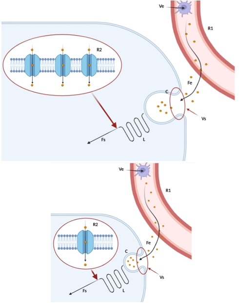
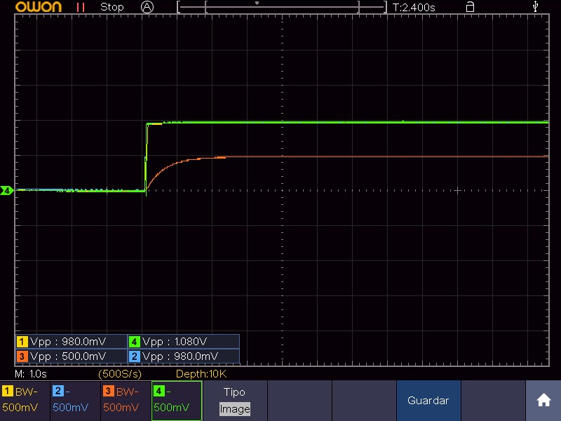

# Práctica 4 — Modelado y control del sistema endocrino

Repositorio académico de la asignatura **Modelado de Sistemas Fisiológicos**, correspondiente al programa de **Ingeniería Biomédica** del Tecnológico Nacional de México / Instituto Tecnológico de Tijuana. Esta práctica integra analogías eléctricas de sistemas fisiológicos, modelado matemático, análisis temporal y de estabilidad, simulación en MATLAB/Simulink y Python, diseño de un controlador PID y comprobación experimental en el Laboratorio de Electrónica.

El caso de estudio representa de forma **fenomenológica** los procesos de secreción, transporte, almacenamiento y respuesta hormonal mediante un **circuito eléctrico de segundo orden** ($R_1$, $C$, $L$ y $R_2$). Se compara una condición de referencia (**control**) con una condición alterada (**caso**) y se diseña un controlador PID que acerque la respuesta del caso a la del control.

**Docente:** Dr. Paul Antonio Valle Trujillo  
**Correo:** paul.valle@tectijuana.edu.mx  
**Departamento:** Ingeniería Eléctrica y Electrónica  
**Institución:** Tecnológico Nacional de México / Instituto Tecnológico de Tijuana  
**Asignatura:** Modelado de Sistemas Fisiológicos  
**Programa:** Ingeniería Biomédica  
**Estudiante:** Morales Díaz Ramón Iván · 24210589 · l24210589@tectijuana.edu.mx

**Repositorio de la práctica:** https://github.com/l24210589-ops/MSFP4  
**Repositorio de la asignatura:** https://github.com/DrPaulValle/MSF-IBF1020  
**Sede:** Blvd. Alberto Limón Padilla s/n, Tijuana, C. P. 22454, B. C., México.

---

<a id="contenido"></a>
## Contenido

1. [Resumen](#resumen)
2. [Competencia y objetivos](#objetivos)
3. [Relación con el temario](#temario)
4. [Modelo fisiológico y analogía eléctrica](#analogia)
5. [Formulación matemática](#modelo)
6. [Análisis temporal y de estabilidad](#analisis)
7. [Condiciones de simulación y señales](#senales)
8. [Implementación en MATLAB y Simulink](#matlab)
9. [Control en lazo cerrado con PID](#pid)
10. [Reproducción en Python](#python)
11. [Laboratorio](#laboratorio)
12. [Resultados y verificación cruzada](#resultados)
13. [Actividades del estudiante](#actividades)
14. [Estructura del repositorio](#estructura)
15. [Requisitos](#requisitos)
16. [Reproducibilidad y entregables](#reproducibilidad)
17. [Referencias](#referencias)

---

<a id="resumen"></a>
## Resumen

La práctica modela un compartimento endocrino simplificado con un circuito eléctrico que tiene una rama principal formada por la fuente de estímulo $V_e(t)$ y la resistencia de transporte $R_1$, y, en el nodo posterior, un capacitor $C$ a tierra en paralelo con una segunda rama formada por el inductor $L$ y la resistencia $R_2$ en serie. La salida $V_s(t)$ se mide en el nodo de unión entre $R_1$, $C$ y $L$. Por tener dos elementos independientes de almacenamiento de energía ($C$ y $L$), el sistema es de **segundo orden**.

Se formulan las **ecuaciones integro-diferenciales (EID)** con las leyes de Kirchhoff y se obtiene la función de transferencia $G(s)=V_s(s)/V_e(s)$. Control y caso comparten $R_1$ y $L$ y difieren en $C$ y $R_2$: el control tiene $C=1\,\mu\mathrm{F}$ y $R_2=100\,\mathrm{k}\Omega$, y el caso $C=1000\,\mu\mathrm{F}$ y $R_2=1\,\mathrm{k}\Omega$. Ante un escalón unitario, el control alcanza $0.99\,\mathrm{V}$ casi de inmediato y el caso solo $0.50\,\mathrm{V}$ y con una dinámica unas 500 veces más lenta. Para reducir esa diferencia se diseña un **controlador PID con retroalimentación negativa** que toma la respuesta del control como referencia. Los resultados se obtienen con MATLAB/Simulink (modelo `Sistemas`), se simulan en sus tres representaciones (EID, función de transferencia y circuito equivalente), se reproducen en Python y se comparan con una captura del osciloscopio del laboratorio.

**Palabras clave:** circuito RLC; controlador PID; sistema endocrino; modelado de sistemas fisiológicos; MATLAB; Simulink; Simscape Electrical; Python; simulación *in silico*; instrumentación electrónica.

[Volver al contenido](#contenido)

---

<a id="objetivos"></a>
## Competencia y objetivos

### Competencia a desarrollar

Modelar sistemas fisiológicos mediante analogías eléctricas, ecuaciones diferenciales y funciones de transferencia para analizar su comportamiento dinámico y diseñar estrategias de control mediante técnicas de control clásico. En particular, el estudiante interpreta una descripción simplificada de los procesos de secreción, transporte, almacenamiento y respuesta hormonal para proponer un circuito eléctrico equivalente de segundo orden; compara una condición de referencia (*control*) con una condición alterada (*caso*), diseña un controlador PID y contrasta los resultados obtenidos mediante modelado analítico, simulación computacional y experimentación en el Laboratorio de Electrónica.

### Objetivo general

Modelar, simular y controlar un sistema endocrino simplificado mediante un circuito eléctrico equivalente de segundo orden, y diseñar un controlador PID que reduzca la diferencia entre la respuesta del caso y la del control.

### Objetivos específicos

- Interpretar la descripción fisiológica y construir los circuitos equivalentes del control y del caso.
- Obtener la función de transferencia $G(s)=V_s(s)/V_e(s)$ de cada condición con la transformada de Laplace.
- Formular las ecuaciones integro-diferenciales con las leyes de Kirchhoff.
- Calcular el valor final, el error en estado estacionario y los polos de control y caso, y analizar el efecto de $C$ y $R_2$.
- Simular ambas condiciones en Simulink con EID, función de transferencia y circuito equivalente (Simscape Electrical).
- Sintonizar un controlador PID con retroalimentación negativa que tome al control como referencia.
- Reproducir las respuestas en MATLAB y en Python con las mismas ganancias.
- Comparar simulación y experimentación en el laboratorio.
- Documentar los resultados en un repositorio de GitHub.

[Volver al contenido](#contenido)

---

<a id="temario"></a>
## Relación con el temario

La práctica integra contenidos de tres unidades de la asignatura **Modelado de Sistemas Fisiológicos (IBF-1020)**:

| Unidad | Área | Contenidos aplicados |
|---|---|---|
| I | Sistemas de control retroalimentados | Diagramas de bloques, señal de error, lazo abierto y cerrado, error en estado estacionario y estabilidad |
| II | Modelado matemático | Analogías eléctricas, leyes de Kirchhoff, ecuaciones integro-diferenciales y función de transferencia |
| III | Controladores | Diseño del PID, sintonización de ganancias e implementación analógica |

[Volver al contenido](#contenido)

---

<a id="analogia"></a>
## Modelo fisiológico y analogía eléctrica

El sistema endocrino regula numerosos procesos mediante la liberación de hormonas producidas por glándulas especializadas. Una vez secretadas, las hormonas se transportan por la circulación hasta tejidos u órganos diana, donde interactúan con receptores específicos. Para introducir el estudio de su dinámica con analogías eléctricas, el proceso se representa con un modelo fenomenológico simplificado que reproduce de manera cualitativa el almacenamiento, la disipación, el retardo y la inercia de la respuesta.



*Esquema del sistema endocrino elaborado en BioRender, con las variables y los elementos del circuito eléctrico equivalente.*

### Correspondencias de la analogía

| Variable o proceso fisiológico | Representación eléctrica | Interpretación dentro del modelo |
|---|---|---|
| Estímulo para la secreción hormonal | $V_e(t)$ | Señal de entrada que activa la respuesta del sistema endocrino |
| Flujo de secreción y transporte hormonal | $F_e(t)$ | Corriente asociada con la transferencia de la señal hormonal desde la fuente hacia el compartimento de respuesta |
| Pérdidas y oposición durante el transporte | $R_1$ | Procesos que reducen o retardan la transmisión de la señal hormonal |
| Acumulación temporal de hormona | $C$ | Capacidad del compartimento para almacenar temporalmente la señal hormonal antes de su utilización o eliminación |
| Retardo o inercia de la respuesta del tejido diana | $L$ | Resistencia dinámica del sistema a cambios rápidos en la respuesta hormonal |
| Utilización, disipación o eliminación de la señal | $R_2$ | Oposición efectiva a la utilización o desaparición de la señal hormonal en el compartimento de respuesta |
| Flujo asociado con la respuesta del tejido diana | $F_s(t)$ | Corriente de la rama que representa la respuesta del órgano diana |
| Nivel hormonal efectivo | $V_s(t)$ | Variable de salida que representa de manera normalizada la señal hormonal disponible en el compartimento de interés |

### Topología del circuito equivalente

La fuente $V_e(t)$ y el resistor $R_1$ forman la rama principal, con el flujo de entrada $F_e(t)$. En el nodo posterior a $R_1$, donde se mide $V_s(t)$, el capacitor $C$ está conectado a la referencia, en paralelo con la rama formada por $L$ y $R_2$ en serie, por la que circula el flujo de salida $F_s(t)$. Por tanto, la corriente del capacitor es $F_e(t)-F_s(t)$.

### Valores de los componentes

| Componente | Control | Caso |
|---|---:|---:|
| $R_1$ | 1 kΩ | 1 kΩ |
| $L$ | 100 mH | 100 mH |
| $C$ | 1 µF | 1000 µF |
| $R_2$ | 100 kΩ | 1 kΩ |

La modificación simultánea de $C$ y $R_2$ produce una dinámica distinta entre control y caso, y permite analizar cómo cambian las propiedades de almacenamiento y de disipación sobre la respuesta temporal.

> **Alcance de la analogía:** las correspondencias anteriores constituyen una analogía fenomenológica con fines académicos. Las unidades y los valores de los componentes eléctricos no representan directamente magnitudes fisiológicas del sistema endocrino.

[Volver al contenido](#contenido)

---

<a id="modelo"></a>
## Formulación matemática

El desarrollo a mano está en el PDF [`AnálisisMatematicoP4.pdf`](An%C3%A1lisisMatematicoP4.pdf) (10 hojas: circuito y EID en las hojas 1–3, función de transferencia en las hojas 4–5, estabilidad en la hoja 6, error en estado estacionario en la hoja 7, modelo integro-diferencial en las hojas 8–9 y bosquejo en la hoja 10) y se resume a continuación.

### 1. Ecuaciones integro-diferenciales (EID)

Aplicando las leyes de Kirchhoff al nodo de $V_s$ y a la rama $L$–$R_2$:

$$
F_e(t)=\frac{V_e(t)-V_s(t)}{R_1}=C\frac{dV_s(t)}{dt}+F_s(t),\qquad
V_s(t)=L\frac{dF_s(t)}{dt}+R_2F_s(t).
$$

Despejando las variables asociadas con los dos elementos de almacenamiento:

$$
\boxed{
\begin{aligned}
V_s(t)&=\frac{1}{C}\int_0^t\left[F_e(\tau)-F_s(\tau)\right]d\tau,\\[4pt]
F_s(t)&=\frac{1}{L}\int_0^t\left[V_s(\tau)-R_2F_s(\tau)\right]d\tau,
\end{aligned}}
\qquad F_e(t)=\frac{V_e(t)-V_s(t)}{R_1}.
$$

Equivalentemente, con $V_s$ y $F_s$ como variables de estado:

$$
\frac{dV_s(t)}{dt}=\frac{V_e(t)-V_s(t)}{R_1C}-\frac{F_s(t)}{C},\qquad
\frac{dF_s(t)}{dt}=\frac{V_s(t)-R_2F_s(t)}{L}.
$$

### 2. Función de transferencia

Con condiciones iniciales nulas, la impedancia del capacitor es $1/(Cs)$ y la del inductor $Ls$. La ecuación del nodo queda

$$
\frac{V_e(s)-V_s(s)}{R_1}=CsV_s(s)+\frac{V_s(s)}{Ls+R_2}.
$$

Multiplicando por $R_1(Ls+R_2)$ y agrupando:

$$
V_e(s)(Ls+R_2)=V_s(s)\left[R_1LC\,s^2+(L+R_1R_2C)\,s+(R_1+R_2)\right],
$$

de donde

$$
\boxed{G(s)=\frac{V_s(s)}{V_e(s)}=\frac{Ls+R_2}{R_1LC\,s^2+(L+R_1R_2C)\,s+(R_1+R_2)}.}
$$

El denominador es de segundo grado porque el circuito tiene dos elementos independientes de almacenamiento de energía, $C$ y $L$.

### 3. Funciones de transferencia de control y caso

Sustituyendo los valores de cada condición:

$$
G_{control}(s)=\frac{0.1\,s+10^{5}}{10^{-4}s^2+100.1\,s+1.01\times10^{5}},
\qquad
G_{caso}(s)=\frac{0.1\,s+10^{3}}{0.1\,s^2+1000.1\,s+2000}.
$$

[Volver al contenido](#contenido)

---

<a id="analisis"></a>
## Análisis temporal y de estabilidad

### 1. Valor final y error en estado estacionario

Ante un escalón unitario $V_e(s)=1/s$, el valor final es la ganancia en continua:

$$
\lim_{t\to\infty}V_s(t)=G(0)=\frac{R_2}{R_1+R_2},\qquad
e_{ss}=\lim_{s\to0}\left[1-G(s)\right]=\frac{R_1}{R_1+R_2}.
$$

| Condición | $G(0)=R_2/(R_1+R_2)$ | $e_{ss}=R_1/(R_1+R_2)$ |
|---|---:|---:|
| Control | 0.9901 (≈ 0.99 V) | 0.0099 |
| Caso | 0.5000 (0.50 V) | 0.5000 |

El caso se queda en la mitad del valor de entrada, mientras que el control prácticamente lo iguala.

### 2. Polos, ceros y estabilidad

Los polos satisfacen $R_1LC\,s^2+(L+R_1R_2C)\,s+(R_1+R_2)=0$.

| Condición | Polos [s⁻¹] | Cero [s⁻¹] | $\zeta$ | Comportamiento |
|---|---|---:|---:|---|
| Control | $-1010.01$ y $-999\,989.99$ | $-10^{6}$ | 15.7 | Estable, **sobreamortiguado** |
| Caso | $-2.0002$ y $-9998.9998$ | $-10^{4}$ | 35.4 | Estable, **sobreamortiguado** |

Los cuatro polos son reales negativos, por lo que ambos sistemas son estables y no oscilan. En los dos casos el polo rápido queda prácticamente sobre el cero ($-999\,990$ frente a $-10^{6}$ y $-9999$ frente a $-10^{4}$), de modo que se cancelan casi por completo y cada sistema se comporta, en la práctica, como uno de primer orden dominado por su polo lento:

| Condición | Polo dominante | Constante de tiempo | Tiempo de establecimiento (2 %) |
|---|---:|---:|---:|
| Control | $-1010.01$ | $\approx0.99$ ms | $\approx3.9$ ms |
| Caso | $-2.0002$ | $\approx0.5$ s | $\approx2$ s |

El polo dominante es aproximadamente $(R_1+R_2)/(L+R_1R_2C)$. En el caso, $R_1R_2C$ es 10 veces mayor ($1000$ frente a $100$) y $R_1+R_2$ es 50 veces menor ($2\,\mathrm{k}\Omega$ frente a $101\,\mathrm{k}\Omega$), por lo que su polo dominante queda unas 500 veces más cerca del origen y su respuesta es unas 500 veces más lenta.

### 3. Bosquejo previo

Antes de simular se elaboró un bosquejo cualitativo de las respuestas al escalón (hoja 10 de [`AnálisisMatematicoP4.pdf`](An%C3%A1lisisMatematicoP4.pdf)): el control sube rápido hasta ≈ 0.99, el caso sube más despacio hasta ≈ 0.50 y el caso con PID alcanza al control con un pequeño sobreimpulso.

[Volver al contenido](#contenido)

---

<a id="senales"></a>
## Condiciones de simulación y señales

| Parámetro | MATLAB/Simulink | Python |
|---|---|---|
| Intervalo | $0\le t\le10\,\mathrm{s}$ (`StopTime = 10`) | $0\le t\le10\,\mathrm{s}$ |
| Paso | `MaxStep = 1e-3` s | $\Delta t=5\times10^{-5}$ s ($n=200001$) |
| Método | `ode15s` | `control.forced_response` |
| Condiciones iniciales | Nulas | $x_0=0$ |

**Entrada:** escalón unitario $V_e(t)=u(t)$, que representa un estímulo sostenido aplicado al sistema.

**Señales de salida:**

- $V_{sX}(t)$: salida del control (referencia).
- $V_{sY}(t)$: salida del caso, sin controlador.
- $PID(t)$: salida del caso con controlador (tratamiento).
- $EID$: salida del caso obtenida con el modelo de ecuaciones integro-diferenciales.

**Señal de error:** para el diseño del control, la respuesta del control es la referencia del caso:

$$
e(t)=V_{s,control}(t)-V_{s,caso}(t).
$$

[Volver al contenido](#contenido)

---

<a id="matlab"></a>
## Implementación en MATLAB y Simulink

El cuaderno MATLAB (*live script*) `Ramon24210589P1.mlx` abre el modelo `Sistemas`, lo simula con `StopTime` de 10 s, solver `ode15s` y `MaxStep` de 1e-3 s y grafica los resultados con la función `plotsignals`, que se llama una vez con la etiqueta `Caso`: $V_e(t)$, el tratamiento con controlador, el caso, el control y el caso obtenido con las EID. La función `plotsignals(t,x1,x2,x3,x4,x5,signal)` grafica cinco señales con distintos estilos de línea, con ejes en $-0.25\le t\le10\,\mathrm{s}$ y $-0.2\le V\le1.4\,\mathrm{V}$, leyenda en LaTeX, y exporta la figura en PDF vectorial con el nombre `<signal>_matlab.pdf` (aquí, `Caso_matlab.pdf`). El cuaderno incluye además la sección **Modelo EDOs** con la función local `endocrino(par,Ve,t)`, que resuelve el modelo en variables de estado $x=[V_s;\,i_L]$ con `par = [R1 R2 L C]` mediante Euler implícito; la curva $EID$ de la figura proviene del subsistema de EID del modelo de Simulink (`x.CASO`).

### Modelo de Simulink

El modelo contiene los subsistemas **Control** y **Caso**, y la planta se implementa de tres formas para compararlas, como pide el instructivo:

- **Ecuaciones integro-diferenciales (EID):** un subsistema por condición, con dos integradores, ganancias $1/C$, $1/L$, $1/R_1$ y $R_2$ y bloques de suma, construido directamente a partir de las EID.
- **Función de transferencia (FT):** bloque de función de transferencia con $G(s)$.
- **Circuito equivalente (CE):** componentes de Simscape Electrical (fuente de voltaje controlada, $R_1$, $C$, inductor, $R_2$, sensor de voltaje y referencia eléctrica).

El subsistema del caso incluye además el bloque **PID Controller** en un lazo con retroalimentación negativa (bloque de suma) cuya referencia es la salida del control. Las señales de entrada, control, caso, tratamiento y EID del caso se envían al *Workspace* y a osciloscopios (*scopes*). En el osciloscopio de Simulink, el control se estabiliza en $0.99\,\mathrm{V}$ y el caso en $0.50\,\mathrm{V}$, como predice el análisis.

### Esquema general de control

Se utiliza el esquema de la Figura 5.5 del instructivo:

1. El mismo escalón $V_e(t)$ alimenta al **control** y al **caso**.
2. La salida del control es la **referencia** del lazo.
3. En el sumador se resta (retroalimentación negativa) la salida del caso con tratamiento.
4. El error pasa por el PID (protocolo), que actúa sobre el paciente (tratamiento).
5. Las señales se comparan en el *scope*.

[Volver al contenido](#contenido)

---

<a id="pid"></a>
## Control en lazo cerrado con PID

### 1. Retroalimentación negativa

La referencia es la salida del control, así que el error es

$$
e(t)=V_{sX}(t)-V_{sT}(t),
$$

donde $V_{sT}(t)$ es la salida del caso con tratamiento. Con $K(s)$ el controlador y $G_{caso}(s)$ la planta del caso, la función de transferencia de lazo cerrado es

$$
T(s)=\frac{K(s)\,G_{caso}(s)}{1+K(s)\,G_{caso}(s)}.
$$

### 2. Sintonización

Se utilizó la herramienta **Tune** del bloque `PID Controller` de Simulink. El controlador tiene acción derivativa con filtro:

$$
K(s)=k_P+\frac{k_I}{s}+k_D\frac{N\,s}{s+N}.
$$

| Parámetro | Valor sintonizado en Simulink | Valor usado en el script de Python |
|---|---:|---:|
| $k_P$ | 1298.6989 | 1298.6989 |
| $k_I$ | 312346.1725 | 312346.1725 |
| $k_D$ | 0.17968 | 0.17968 |
| $N$ | 4964.0941 | 4964.0941 |

La captura de la sintonización, con los parámetros y el desempeño, está en [`ParametrosControlador.pdf`](ParametrosControlador.pdf).

### 3. Desempeño en lazo cerrado

| Medida | Simulink (Tuned) | Verificación numérica |
|---|---:|---:|
| Tiempo de subida | 0.00133 s | 0.00133 s |
| Tiempo de establecimiento | 0.0102 s | 0.0102 s |
| Sobreimpulso | 10.1 % | 10.14 % |
| Pico | 1.1 | 1.10 |
| Margen de fase | 90° @ 1.36×10³ rad/s | — |
| Estabilidad de lazo cerrado | Estable | Estable |

La verificación numérica se hizo con la función de transferencia de lazo cerrado $T(s)$ y las ganancias del script. Es de cuarto orden (dos polos de la planta y dos del PID), con polos en $-9998.56$, $-6086.77$, $-713.16$ y $-357.24\,\mathrm{s^{-1}}$ (todos con parte real negativa) y ceros en $-10000$, $-2835.90$ y $-249.58\,\mathrm{s^{-1}}$.

Como el integrador da $T(0)=1$, el caso con tratamiento **sigue al control sin error en estado estacionario**: el error final con tratamiento es prácticamente cero, frente a $0.49\,\mathrm{V}$ del caso sin controlador. El tratamiento alcanza el valor de referencia en alrededor de $0.011\,\mathrm{s}$, con un pico de $1.069\,\mathrm{V}$, frente a los $\approx2\,\mathrm{s}$ que necesita el caso por sí solo.

> **Alcance:** la estrategia de control tiene propósitos exclusivamente académicos y de simulación.

[Volver al contenido](#contenido)

---

<a id="python"></a>
## Reproducción en Python

El script `Practica4.py` reproduce los resultados con una segunda herramienta. Sus apartados son:

1. **Datos generales:** $x_0=0$, $t\in[0,10]$ con $\Delta t=5\times10^{-5}$ s ($n=200001$), entrada escalón unitario $V_e(t)$ y tamaño de figura de $7.5\times4.6$ pulgadas.
2. **Ganancias del PID:** $k_P$, $k_I$, $k_D$ y $N$ obtenidas con *Tune*.
3. **Función `G(C, R2)`:** construye $G(s)$ con $R_1=1\,\mathrm{k}\Omega$ y $L=0.1\,\mathrm{H}$, con numerador $[L,\;R_2]$ y denominador $[R_1LC,\;L+R_1R_2C,\;R_1+R_2]$.
4. **Control y caso:** `control = G(1e-6, 100e3)` y `caso = G(1e-3, 1e3)`.
5. **Controlador PID:** $k_P+k_I/s$, más el término derivativo filtrado $k_DNs/(s+N)$ cuando $k_D\ne0$.
6. **Lazo cerrado:** `ctrl.feedback(ctrl.series(PID, caso), 1, sign=-1)`; imprime los polos del lazo cerrado.
7. **Respuestas forzadas:** control y caso ante el escalón con `ctrl.forced_response`, y tratamiento con la salida del control como referencia; imprime el valor final del control, del caso y del PID, y el máximo del tratamiento.
8. **Figura:** grafica $V_e(t)$, tratamiento, caso y control, con ejes $0\le t\le10\,\mathrm{s}$ y $-0.2\le V\le1.2\,\mathrm{V}$, leyenda horizontal sobre la gráfica, y la guarda como `Caso.pdf`.

Para ejecutarlo se necesitan las bibliotecas `numpy`, `control` y `matplotlib` (instalables con `pip`); no requiere archivos de entrada porque todas las señales se construyen dentro del script.

[Volver al contenido](#contenido)

---

<a id="laboratorio"></a>
## Laboratorio

El instructivo plantea construir en protoboard los circuitos del control y del caso con los valores comerciales indicados, aproximar el escalón unitario con el generador de funciones y registrar con el osciloscopio $V_e(t)$ y $V_s(t)$, primero en lazo abierto y después con el controlador analógico (alimentación simétrica de los amplificadores operacionales) en lazo cerrado.



*Captura del osciloscopio (base de tiempo de 1 s/div, 500 mV/div en los cuatro canales, 500 S/s).*

| Canal | $V_{pp}$ medido | Interpretación |
|---|---:|---|
| CH1 | 980 mV | Mismo nivel que el control (0.99 V simulado) |
| CH2 | 980 mV | Mismo nivel que el control (0.99 V simulado) |
| CH3 (naranja) | 500 mV | Caso, sin controlador (0.50 V simulado) |
| CH4 (verde) | 1.080 V | Tratamiento con PID, incluyendo el sobreimpulso (1.069 V simulado) |

Las trazas de CH1 y CH2 terminan en el mismo nivel que la verde y quedan cubiertas por ella. El caso sube de forma exponencial en un par de segundos, coherente con $\tau\approx0.5\,\mathrm{s}$; el tratamiento sube de forma casi instantánea a la escala de la captura (el tiempo de establecimiento simulado es de $0.0102\,\mathrm{s}$, mucho menor que la resolución de $1\,\mathrm{s/div}$) y alcanza el nivel del control con un pequeño sobreimpulso.

**Resultados del estudiante:** agregar el cálculo y los valores comerciales de los componentes del controlador analógico, las fotografías de los montajes y el resto de las capturas del osciloscopio (lazo abierto de control y caso).

[Volver al contenido](#contenido)

---

<a id="resultados"></a>
## Resultados y verificación cruzada

### Archivos de resultados

| Figura | MATLAB/Simulink | Python |
|---|---|---|
| $V_e(t)$, tratamiento, caso y control ante el escalón (MATLAB incluye también la curva del caso por EID) | [`Caso_matlab.pdf`](Caso_matlab.pdf) | [`Caso.pdf`](Caso.pdf) |

Los PDF se enlazan para su consulta porque GitHub no los presenta como imágenes incrustadas.

### Comparación de resultados

| Resultado | Análisis | Simulink | Python | Laboratorio |
|---|---:|---:|---:|---:|
| Control, valor final | 0.99 V | 0.99 V | 0.99 V | 0.98 V |
| Caso, valor final | 0.50 V | 0.50 V | 0.50 V | 0.50 V |
| Tratamiento, pico | — | ≈ 1.07 V | 1.069 V | 1.080 V |
| Sobreimpulso del PID (escalón de referencia unitario) | 10.14 % (cálculo numérico) | 10.1 % | — | — |

Las respuestas del caso obtenidas con las EID y con la función de transferencia se superponen en `Caso_matlab.pdf`, y la figura de Python reproduce las mismas curvas de control, caso y tratamiento.

### Aspectos para discutir

- Cómo $C$ y $R_2$ determinan tanto el valor final ($R_2/(R_1+R_2)$) como la rapidez de la respuesta del control y del caso.
- Efecto del PID: elimina el error en estado estacionario y acelera la respuesta del caso, a costa de un sobreimpulso cercano a 10 %.
- Coincidencia entre las EID, la función de transferencia, el circuito equivalente, MATLAB, Python y el osciloscopio.
- Posibles diferencias entre simulación y laboratorio: tolerancias de resistores, capacitores e inductores; resistencia interna del inductor; tolerancia y resistencia serie equivalente del capacitor; valores comerciales del controlador; no idealidad de los amplificadores operacionales; limitaciones de los instrumentos; y la aproximación experimental del escalón.
- Limitaciones de la analogía fenomenológica.

### Notas de verificación

- **Valor final y error:** en la hoja 7 de `AnálisisMatematicoP4.pdf` se obtiene el valor final $R_2/(R_1+R_2)$ ($0.9901$ y $0.50$) y el error en estado estacionario $1-V_s(\infty)$: $0.99\,\%$ para el control y $50\,\%$ para el caso.
- **Columna *Block* de `ParametrosControlador.pdf`:** muestra los valores por defecto del bloque ($P=1$, $I=1$, $D=0$, $N=100$), porque la captura se tomó antes de actualizar el bloque; las ganancias de esta práctica son las de la columna *Tuned*, que son las que tiene el bloque `PID Controller` del modelo `Sistemas.slx` y las del script de Python.
- **Paso máximo de Simulink:** el modelo `Sistemas.slx` está guardado con `MaxStep = 1e-2`, pero el cuaderno lo sobrescribe con `1e-3` al simular.
- **Nombre de la figura de Python:** el script `Practica4.py` guarda la figura como `Caso.pdf` (sin el sufijo `_python`).
- **Etiqueta del eje vertical:** en Python es $V_e(t)$ [V] y en MATLAB es $V(t)$ [V]; la segunda describe mejor a todas las señales graficadas.
- **Canales del osciloscopio:** la captura no indica qué señal corresponde a CH1 y CH2; la asignación de la tabla se basa en las amplitudes medidas.

**Resultados del estudiante:** agregar un comentario interpretativo propio sobre cada familia de respuestas y las conclusiones de la práctica.

[Volver al contenido](#contenido)

---

<a id="actividades"></a>
## Actividades del estudiante

### Etapa 1. Formulación y análisis

- [ ] Construir los circuitos equivalentes del control y del caso, identificando $V_e(t)$, $V_s(t)$, $R_1$, $C$, $L$, $R_2$, $F_e(t)$, $F_s(t)$, los nodos y la referencia.
- [ ] Obtener $G(s)=V_s(s)/V_e(s)$ para control y caso y relacionar su orden con $C$ y $L$.
- [ ] Calcular el valor final y el error en estado estacionario ante un escalón unitario.
- [ ] Calcular los polos, representarlos en el plano complejo y determinar la estabilidad.
- [ ] Elaborar el bosquejo cualitativo de las respuestas al escalón.
- [ ] Formular las ecuaciones integro-diferenciales con las leyes de Kirchhoff.

### Etapa 2. Simulación en lazo abierto

- [ ] Implementar en Simulink las EID, la función de transferencia y el circuito equivalente (Simscape Electrical) de control y caso.
- [ ] Aplicar el escalón unitario en $0\le t\le10$ s y comparar control y caso.
- [ ] Verificar que las tres representaciones sean consistentes.

### Etapa 3. Diseño y comprobación del controlador

- [ ] Construir el lazo cerrado con el control como referencia y el bloque `PID Controller`.
- [ ] Sintonizar con *Tune* y registrar $k_P$, $k_I$ y $k_D$ con la evidencia de la configuración.
- [ ] Analizar el efecto del controlador sobre el error, la rapidez y el estado estacionario.
- [ ] Desarrollar el cuaderno de MATLAB con la función de gráficas y guardar las figuras en PDF.
- [ ] Reproducir las respuestas en Python con las mismas ganancias.
- [ ] Calcular y simular el controlador analógico con amplificadores operacionales y compararlo con el PID ideal.

### Etapa 4. Experimentación y documentación

- [ ] Construir y medir en protoboard los circuitos de control y caso en lazo abierto.
- [ ] Construir el controlador analógico, conectarlo al caso y registrar lazo abierto y cerrado.
- [ ] Comparar simulación y experimentación.
- [ ] Redactar la discusión y las conclusiones.
- [ ] Publicar los archivos, el `README.md` y el `CITATION.cff` en GitHub.

[Volver al contenido](#contenido)

---

<a id="estructura"></a>
## Estructura del repositorio

Organización de la entrega, con los nombres de los archivos tal como se generaron:

```text
.
├── README.md                          # Reporte y guía de reproducción
├── CITATION.cff                       # Datos de citación del repositorio
├── Ramon24210589P1.mlx                # Cuaderno MATLAB del estudiante
├── Ramon24210589P1.pdf                # Exportación del cuaderno MATLAB
├── Practica4.py                       # Implementación en Python
├── Sistemas.slx                       # Modelo Simulink/Simscape
├── AnálisisMatematicoP4.pdf           # Desarrollo analítico a mano
├── ParametrosControlador.pdf          # Captura de la sintonización del PID
├── Caso_matlab.pdf                    # Figura generada en MATLAB
├── Caso.pdf                           # Figura generada en Python
├── CasoTratamiento_Lab.jpeg           # Captura del osciloscopio (laboratorio)
└── Biorender_endo.jpeg                # Esquema del sistema endocrino (BioRender)
```

**Criterio de nombres:** los archivos conservan los nombres con que se generaron. Si se renombra alguno en GitHub, actualizar también su enlace en este README.

[Volver al contenido](#contenido)

---

<a id="requisitos"></a>
## Requisitos

### Software

- **MATLAB** y **Simulink**, con el modelo `Sistemas.slx` y el cuaderno `Ramon24210589P1.mlx`.
- **Simscape Electrical**, para el circuito eléctrico equivalente del modelo.
- Herramientas de Simulink para la sintonización del bloque **PID Controller**.
- **Python** (por ejemplo, con **Visual Studio Code**) y las bibliotecas `numpy`, `control` y `matplotlib`.
- **Git y GitHub** para presentar el repositorio.

Las versiones mínimas del software no se especifican en el instructivo.

### Recursos de laboratorio

Resistores, capacitores e inductor de los valores indicados, amplificadores operacionales y componentes del controlador analógico, protoboard, alimentación simétrica, generador de funciones, osciloscopio, cables y medio de almacenamiento para las capturas.

[Volver al contenido](#contenido)

---

<a id="reproducibilidad"></a>
## Reproducibilidad y entregables

### Secuencia de reproducción

1. Consultar el [repositorio general de la asignatura](https://github.com/DrPaulValle/MSF-IBF1020) y descargar los archivos de la práctica.
2. Verificar la topología del circuito y los valores de $R_1$, $L$, $C$ y $R_2$ de control y caso.
3. Derivar las EID y la función de transferencia, y calcular valor final, error y polos.
4. Ejecutar el cuaderno `Ramon24210589P1.mlx` con el modelo `Sistemas.slx` y exportar la figura en PDF.
5. Sintonizar el PID, registrar las ganancias y guardar la captura de la configuración.
6. Ejecutar `Practica4.py` con las mismas ganancias y obtener la figura `Caso.pdf`.
7. Construir los montajes del laboratorio y registrar las capturas del osciloscopio.
8. Comparar simulación y experimentación y completar este README con las evidencias propias.
9. Publicar el repositorio junto con su `CITATION.cff`.

### Resultados mínimos esperados

| Entregable | Evidencia solicitada |
|---|---|
| Interpretación fisiológica | Descripción del modelo y de la analogía eléctrica |
| Circuito eléctrico | Esquema del circuito equivalente de control y caso |
| Desarrollo matemático | EID, función de transferencia, error, polos y bosquejo |
| Funciones de transferencia | $G_{control}(s)$ y $G_{caso}(s)$ |
| MATLAB y Simulink | Cuaderno `.mlx` con su exportación a `.pdf` y modelo `.slx` |
| Simscape Electrical | Circuitos equivalentes dentro del modelo `.slx` |
| Python | Código `.py` y figura |
| Figuras | Figuras de MATLAB y de Python |
| Sintonización | Ganancias $k_P$, $k_I$, $k_D$ y captura de la configuración |
| Controlador analógico | Cálculo de componentes y comparación con el PID ideal |
| Laboratorio | Fotografías de los montajes y capturas del osciloscopio |
| Comparación | Simulación frente a experimentación |
| Documentación | `README.md`, `CITATION.cff` e interpretación de los resultados |

### Criterios de presentación académica

Debe distinguirse entre **resultados de referencia reproducidos**, **mediciones experimentales propias** y **modificaciones realizadas por el estudiante**. La ejecución de scripts y la generación de figuras no sustituyen la discusión del comportamiento fisiológico, matemático y eléctrico del sistema.

[Volver al contenido](#contenido)

---

<a id="referencias"></a>
## Referencias

[1] P. A. Valle, *Práctica: Modelado y control del sistema endócrino* (sección 5.6), instructivo de la asignatura Modelado de Sistemas Fisiológicos, Tecnológico Nacional de México / Instituto Tecnológico de Tijuana, pp. 96–105.

[2] M. C. Khoo, *Physiological Control Systems: Analysis, Simulation, and Estimation*, 2nd ed., IEEE Press, 2018.

[3] F. C. Hoppensteadt y C. S. Peskin, *Modeling and Simulation in Medicine and the Life Sciences*, Springer.

[4] J. E. Hall, *Guyton and Hall Textbook of Medical Physiology*, 14th ed., Elsevier, 2021.

[5] K. Ogata, *Ingeniería de Control Moderna*, 5.ª ed., Pearson Educación, 2010.

[6] N. S. Nise, *Control Systems Engineering*, 8th ed., John Wiley & Sons, 2020.

[7] P. A. Valle, *Syllabus para Modelado de Sistemas Fisiológicos*, Tecnológico Nacional de México / Instituto Tecnológico de Tijuana, Tijuana, B. C., México, 2026. Disponible en: https://biomath.xyz/course/

[8] Tecnológico Nacional de México, *Programa de estudio de la asignatura Modelado de Sistemas Fisiológicos, IBF-1020*.

---

## Uso académico

Este repositorio se utiliza como evidencia de una práctica de **Modelado de Sistemas Fisiológicos**. Su finalidad es desarrollar habilidades de modelado, análisis, simulación, diseño de control y documentación técnica; cualquier cambio de parámetros, estructura del controlador o procedimiento debe identificarse y justificarse. La analogía eléctrica es fenomenológica y la estrategia de control tiene propósitos exclusivamente académicos y de simulación.
